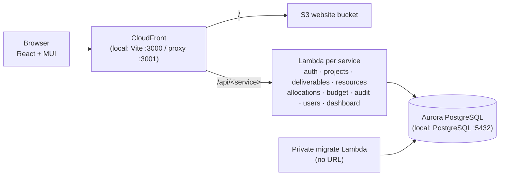

# ACME Project Tracker

A project-tracking platform for ACME Inc.: projects, deliverables and their
dependencies, people and their allocations, budgets, and a dashboard that
explains which projects are at risk, with role-based access control.

Built for the coding workshop (Full Stack track). The workshop's own guides
are in [docs/README.md](./docs/README.md); the rubric is
[docs/full-stack.md](./docs/full-stack.md).

## What it answers

| Business question | Where |
| --- | --- |
| What is the current status of each active project? | Projects list (status, progress, burn); Dashboard |
| Which projects are at risk of missing their deadlines? | Dashboard → *Projects needing attention*, with the reasons |
| How are resources allocated across projects? | Project → *Allocations*; People → a person's next 8 weeks |
| What are the key deliverables and their completion status? | Project → *Deliverables* (status, due date, blocked, overdue) and progress bar |
| Which team members are over-allocated across multiple projects? | People (*over-allocated this week* filter); Dashboard; warning when saving an allocation |
| What is the dependency chain between deliverables? | A deliverable's dialog shows *depends on → it → needed by*; cycles are rejected |
| How much budget has been consumed versus planned? | Project → *Budget* (planned, spent, remaining, burn %, by category); burn in the projects list |

## Architecture



- **Backend:** Python 3.13 Lambdas. Each folder under `backend/` with a
  `requirements.txt` is a service at `/api/<folder>`; shared code lives in
  `backend/_common` (routing and JSON errors, DB, JWT and sessions,
  permissions, validation, audit, risk). Folders starting with `_` are not
  services.
- **Database:** PostgreSQL. Migrations in `backend/_db/migrations`, applied by
  `bin/migrate.sh` locally and by the private `_migrate` Lambda in AWS.
  Derived values (blocked, overdue, progress, over-allocation, burn, at-risk)
  are computed by views and queries, never stored.
- **Frontend:** React 19, Material UI, react-responsive, react-router; every
  page is loaded on demand.
- **Infrastructure:** Terraform (`infra/`), deployed with `bin/deploy-*.sh`.

Details, data model and trade-offs: [docs/acme-project-tracking.md](./docs/acme-project-tracking.md).

## Run it locally

Prerequisites: the workshop VDI set up as in [docs/validation.md](./docs/validation.md)
(`~/.bashrc` exports `AWS_REGION`, `EVENT_ID`, `PARTICIPANT_ID`,
`PARTICIPANT_CODE` and the LocalStack token), Docker, Node 22, Python 3.13 and `psql`.

```sh
source ~/.bashrc
export ADMIN_EMAIL=admin@acme.test                     # first admin, created once
read -rsp "Admin password: " ADMIN_PASSWORD && echo && export ADMIN_PASSWORD
./bin/start-dev.sh                                     # keeps running; open http://localhost:3000
```

`start-dev.sh` starts PostgreSQL and LocalStack, applies the migrations, seeds
the admin, deploys every Lambda to LocalStack and starts the API proxy (:3001)
and the React dev server (:3000). It does not exit; stop it with Ctrl+C.
Sign in as the admin and create other users on the *Users* page.

## Deploy to AWS

```sh
export ADMIN_EMAIL=you@acme.example
read -rsp "Admin password: " ADMIN_PASSWORD && echo && export ADMIN_PASSWORD
./bin/deploy-backend.sh      # Lambdas, CloudFront, migrations + admin seed
./bin/deploy-frontend.sh     # React build → S3 (stale files removed) → CloudFront
```

Both scripts are safe to repeat: a second `deploy-backend.sh` reports *No
changes*, no migrations and an existing admin. Never run
`bin/cleanup-environment.sh` on the shared workshop stack.

## Test

| What | Command | Result |
| --- | --- | --- |
| Backend unit + integration (real PostgreSQL), coverage gate 80% | `backend/.venv/bin/pytest backend/tests --cov --cov-config=backend/.coveragerc` | 163 passed, **95%** (every service ≥ 92%) |
| Frontend components, pages and API clients, coverage gate 80% | `cd frontend && npm run coverage` | 191 passed, **92%** lines, 90% statements, 86% branches, 85% functions |
| End-to-end (Cypress, production build, local stack) incl. axe WCAG 2 A/AA | `cd frontend && npm run e2e` | 9 specs, 19 tests passed |
| API acceptance (curl, local stack) | `tests/acceptance/increment_{a,b,c,d}.sh` | 20 + 15 + 18 + 19 checks passed |
| Sign-in, refresh cookie, sign-out on the deployed site | `tests/acceptance/cloud_auth_check.sh` | asks for an account |
| Load (Artillery) | `tests/load/run.sh cloud` (or `local` for a smoke test) | see [docs/COMPLIANCE.md](./docs/COMPLIANCE.md) |
| Lint and security | `cd backend && .venv/bin/flake8 . && .venv/bin/bandit -r _common _migrate */function.py`; `cd frontend && npm run lint` | clean |

One-time setup for the backend tests:
`python3 -m venv backend/.venv && backend/.venv/bin/pip install -r backend/tests/requirements-dev.txt`.

Critical paths covered end to end: sign in / stay signed in / refresh / sign
out / rate limit; project CRUD and roles; deliverables and the dependency
cycle error; over-allocation warning; budget, burn and activity; dashboard
reasons; user administration; mobile layout; accessibility of every page.

## Roles

| Role | Can |
| --- | --- |
| Admin | Everything, including users and roles, people, and deleting spend |
| Project manager | Create projects; manage their own projects' team lead, deliverables, allocations and budget; delete their projects while they have no spend |
| Team lead | Read everything; create and edit (not delete) deliverables and dependencies in projects they lead |
| Viewer | Read everything except spend line items, change history and the user list |

Every request is checked by the backend (401 / 403); the UI only hides what a
role can't do. Full matrix: [docs/acme-project-tracking.md](./docs/acme-project-tracking.md#roles).

## Decisions and known gaps

Decisions, assumptions and their reasons are in [docs/PLAN.md](./docs/PLAN.md)
and the per-increment notes in [changes/](./changes/). Known gaps:

- No offline/PWA support, real-time updates or AI features (beyond this brief).
- One currency, display only; no audit-log retention policy.
- Refresh tokens are rotated but reuse of an old one doesn't revoke the session family.
- Each concurrent Lambda holds its own database connection; at high
  concurrency an RDS Proxy would be needed (see the load test notes).
- Over-allocation counts partial weeks in full.

## Repository map

| Path | Contents |
| --- | --- |
| `backend/` | Lambda services, `_common` shared code, `_db` migrations, `_migrate`, tests |
| `frontend/` | React app (`src/`), Cypress suite (`cypress/`) |
| `infra/` | Terraform |
| `bin/` | Dev, migration and deploy scripts |
| `tests/` | curl acceptance scripts and the Artillery load test |
| `docs/` | Workshop guides, project docs, plan, compliance |
| `changes/` | What changed in each increment |

## License

See [LICENSE](./LICENSE). Contributing to the workshop template: [CONTRIBUTING.md](./CONTRIBUTING.md).
